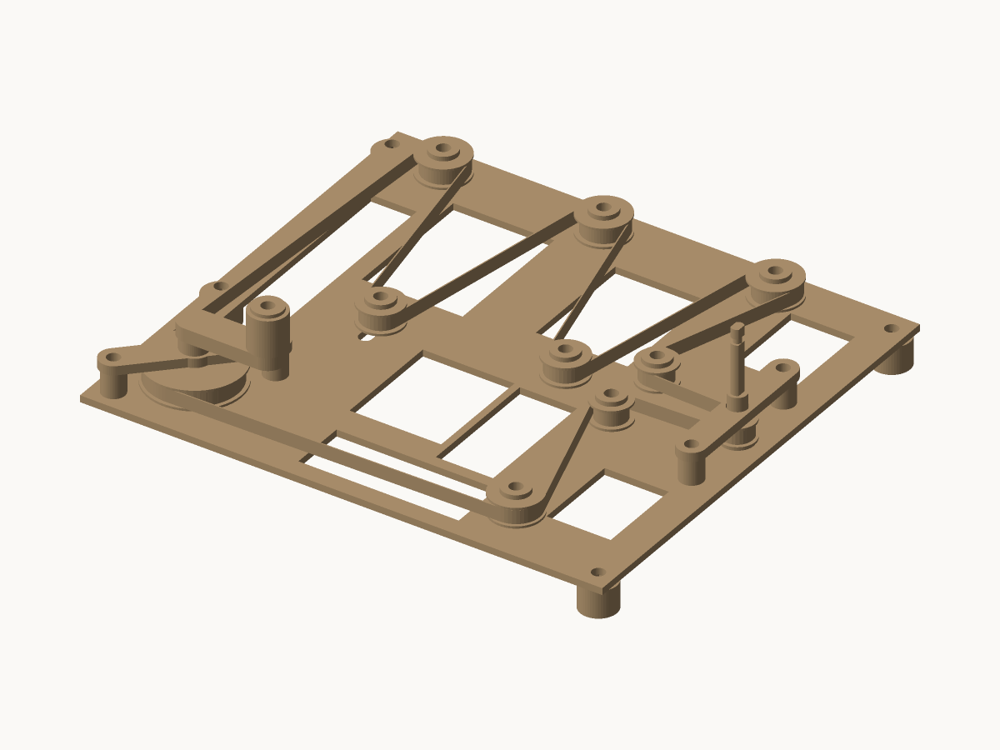

# Belt propeller drive

Uses a spare Bambu X1/P1 Z-axis belt: GT2, 2 mm pitch, 1142 mm closed loop, 571 teeth. A TT motor, or the hand crank swapped in its place, turns a 60-tooth pulley. The belt folds round eight idlers and a slotted tensioner to a 20-tooth output pulley, a **3:1 step-up**, whose shaft carries the TT propellers. A TT motor at about 200 rpm gives about 600 rpm at the propeller. Two crank turns a second gives about 360 rpm. Generated by `sol build.sol`.

## Belt path

A loop between just two pulleys would need about 530 mm between centres. Instead the belt runs, counter-clockwise from the drive pulley:
- along the bottom to an idler;
- round a narrow tongue that holds the output pulley between two neck idlers, giving a 176° wrap (about 10 teeth engaged);
- up to the top right;
- down and up through two notch idlers, one fixed and one the tensioner;
- along the top and back down to the drive.

The pitch line computes to 1142.0 mm with the tensioner at its nominal position. Its slot travels ±10 mm, which takes up about ±20 mm of belt. No two spans cross, and every span clears every pulley it does not wrap by at least 11.6 mm.

**Belt width is assumed to be 6 mm.** Bambu does not publish it. The pulley and idler flanges sit 7 mm apart. Measure your belt, and if it differs, set `beltW` in `build.sol` and regenerate.

## Parts

- **Base:** 228 × 208 mm, 3 mm floor with lightening windows. It carries a pin and shoulder under each pulley, the idler screw holes, the tensioner slot, four bar pillars and four leg holes. It is about 125 g in PLA.
- **Drive pulley:** 60-tooth GT2 with flanges. A top journal runs in the drive bar's bearing. The TT shaft's double-D socket opens upward from inside the pulley.
- **Output pulley:** 20-tooth GT2. A top journal runs in the output bar. The shaft above has the M5 gearbox's profile, shoulder and collar groove, so the TT propellers, spacers and split collar from that gearbox fit unchanged.
- **Idlers:** smooth and flanged, in three sizes (9.0, 7.6 and 6.6 mm radius). Each turns on its own printed post, which has a 1 mm shoulder and is held by a cap and an M5 screw into a nut under the floor. The tensioner's post screw runs in the floor slot, and tightening it locks the position.
- **Drive bar and output bar:** each spans two pillars with a bearing hole over its shaft.
- **Crank, sleeve, knob:** the hand-crank design. The drive pulley's own top journal is the bearing, so the crank is just a stub into the socket, a collar and a 32 mm arm.
- **Motor plate:** replaces the drive bar for motor drive. It is the M5 gearbox's tongue, with clamp slots 32–46 mm out at ±18 mm, laid along the diagonal over the near pillar. The TT motor lies on it, shaft down through the bearing into the drive socket. The gearbox's clamp bridge (`motorBridge`) holds it.
- **Legs:** four, 12 mm tall, each with a captive nut.

Pulley teeth: each groove is a 0.7 mm radius round, 0.75 mm deep, with the outside 0.254 mm under the pitch circle (GT2). Print the pulleys flat. A finer layer height (0.12–0.16 mm) and a slower outer wall help the 20-tooth pulley's grooves.

## Hardware

| Use | Parts |
| --- | --- |
| Idler posts | 8 × M5 × 20, 8 nuts |
| Drive bar or motor plate, output bar | 4 × M5 × 25, 4 nuts |
| Legs | 4 × M5 × 12, 4 nuts (captive in the legs) |
| Crank handle | 1 × M5 × 25, 1 nut |
| TT motor clamp | 2 × M5 sized as for the M5 gearbox, plus 1 mm for the 4 mm plate |
| Propeller | the M5 gearbox's split collar (2 × M5 × 18 and nuts) and spacers |

## Assembly

1. Fit the legs: a nut in each leg's top pocket, then an M5 × 12 down through the floor corner.
2. Put each idler on its post, cap it, and screw it down through the floor into a nut. Run the tensioner's screw through the slot, finger tight, at the inner end.
3. Set the two pulleys on their floor pins. Fit the output bar over the output journal and the drive bar over the drive journal, each with two M5 × 25.
4. Thread the belt along the path in the picture, teeth inward round the pulleys and the convex idlers, and its smooth back on the neck, notch and tensioner idlers. Slide the tensioner out until the belt is taut, then tighten its screw.
5. Fit a propeller, its spacer and the collar as on the M5 gearbox.
6. **Crank:** drop the crank stub into the drive socket through the bar and fit the handle as in `../tt-propeller-gearbox/m5/hand-crank`. **Motor:** replace the drive bar with the motor plate, lay the TT motor on it with the shaft down into the socket, and clamp it with the bridge.

## Checks

- `coscad check belt-drive-crank.assemble` (37 parts) and `belt-drive-motor.assemble` (34 parts) find no overlaps. Both include `belt.coscad`, the belt's cord as a thin band along the computed path. So the check confirms the belt touches only the pulleys and idlers it wraps, and clears every post, cap, bar, pillar and the crank.
- `coscad gears crank-sweep.json` turns the crank a full revolution past the drive-bar screw heads, with at least 1.5 mm clearance.
- Not checked: belt tension and tooth jump under load, idler friction, the printed tooth fit on the real belt, and running speed or thrust.

While building this, `models/lib/num.sol` turned out to give wrong `sin` and `cos` for angles below about −2.4 rad: Sol's `%` keeps the sign, so the quadrant index went negative. It is fixed. The SG90 rack and lift, thumbwheel, spiral launcher and captive-spring models regenerate unchanged.
