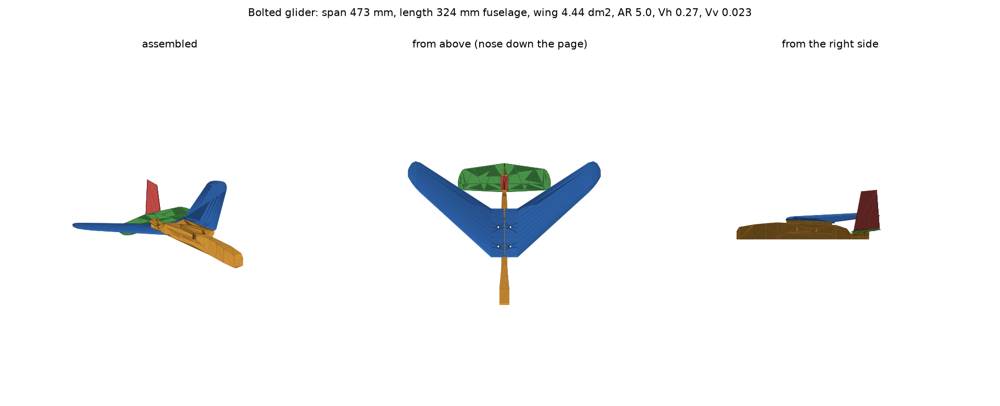

# Balanced bolted glider, revision 2

This revision is designed to balance **without added ballast**, including the screws
and nuts. The estimate is **218.4 g assembled**, CG **90.5 mm aft of the wing root leading
edge**, and **14.7% static margin**. All geometry, hardware-clearance, slicing and nominal
balance gates pass. It is an **unflown prototype**, not a flight-qualified design. The first two beds were
authorized and dispatched on 2026-11-10; completion and physical quality remain unverified.
The original model and its packages remain separately in [`../bolted-glider`](../bolted-glider).



## What changed

- The outer wing panels sweep aft, moving the wing aerodynamic centre behind more of
  the existing mass. The root mounting pads and four M5 wing joints remain.
- The stabilizer centre block, fin foot and tail platform are smaller; the fin blade
  is thinner. Two steel M3 joints replace the heavy M5 tail joints.
- There are no ballast pockets, dense nose inserts or added ballast. The fuselage
  retains its broad forward grip and narrows at the tail.
- The integral tail saddle has **−5.5° incidence**, with both tail surfaces and their
  fastener axes transformed together. The wing retains +2.5° incidence and 6° dihedral.
  This addresses nominal pitching trim as well as CG placement.
- Balance uses the actual sliced extrusion mass distribution, not a solid-mesh centroid
  or an area-based split of the two tail parts. Every screw and nut has its own mass
  and location. Travel, purge, retractions and stationary unretractions are excluded;
  circular extrusion paths use their analytically integrated centroid.

The tradeoff is substantial sweep: about **40° on the outer quarter-chord line**,
**473 mm span** versus 531 mm originally, **4.44 dm²** wing area and aspect ratio **5.05**.
This is a compact swept glider, not a maximum-efficiency sailplane. Sweep, the shortened
horizontal tail arm and unmeasured wing-tail interference make flight validation important.
No claim is made that the original root-load calculation validates the new swept wing.

## Hardware and estimated mass

Use steel button-head screws with these lengths and matching ordinary hex nuts,
**without washers**. Different heads, washers or substitute lengths require rechecking.

| Component | Count | Estimated total |
| --- | ---: | ---: |
| M5 × 12 screws | 4 | 10.4 g |
| M5 nuts, 8 mm across flats | 4 | 4.8 g |
| M3 × 10 screws | 2 | 1.6 g |
| M3 nuts, 5.5 mm across flats | 2 | 0.8 g |
| **Hardware** | **6 screws + 6 nuts** | **17.6 g** |

Hardware masses are design assumptions, not supplier measurements. The fit checks use
nominal M5 head diameter/height 9.5/2.75 mm and M3 5.7/1.65 mm, full thread envelopes,
nut envelopes and protruding screw ends. All 18 fastener envelopes clear the plastic.
Wing nut channels open below; tail nuts enter from opposite sides of the platform.
Do not substitute the original M5 tail hardware: it does not fit this revision.

The remaining approximately 200.8 g is deposited PLA, including the small removable
mouse ears. The resulting flying mass after ear removal will be slightly lower.

## Balance and trim evidence

[`balance.json`](balance.json) records every component mass and centre, the input G-code
hashes, assumptions and acceptance gates. [`validation.json`](validation.json) records
mesh/assembly checks and the aerodynamic calculation. [`packages.json`](packages.json)
identifies the four checked local print packages.

| Property | Current estimate |
| --- | ---: |
| Added ballast | 0 g |
| Assembled mass, including hardware and ears | 218.4 g |
| Longitudinal CG, root LE datum | 90.5 mm |
| Lateral CG offset | 0.37 mm |
| Estimated neutral point, same datum | 105.1 mm |
| Mean aerodynamic chord | 99.4 mm |
| Nominal static margin | 14.7% |
| Tested sensitivity range | 5.25–21.38% |
| Wing loading | 49.2 g/dm² |
| Speed assuming total lift coefficient 0.6 | 11.5 m/s |
| Horizontal / vertical tail volume | 0.266 / 0.023 |

The sensitivity calculation independently varies each printed part by ±5% mass and
±2 mm longitudinal centroid, and **each individual screw and nut** by ±20% mass.
It also varies tail dynamic-pressure efficiency 0.8–1.0 and downwash gradient 0.4–0.65.
The 5% minimum is a design gate over those assumed ranges, **not a confidence interval
or a bound on all aerodynamic uncertainty**. Fuselage destabilization, stall, elastic
wing twist, tip stall and dynamic stability are not represented.

The neutral point is calculated from the lift-slope-weighted wing and tail centres,
including the tail contribution to total lift slope. Wing planform moments are
integrated densely across the actual piecewise-linear stations; empty centreline space
is not counted as lifting area. A swept Helmbold approximation estimates wing lift slope.
This is a preliminary engineering model rather than CFD or a measured polar.

The trim estimate assumes total CL=0.6, wing pitching-moment coefficient −0.06 and
zero-lift angle −3°. It asks for −5.27° tail incidence; the built datum is −5.5°.
Varying the assumed moment coefficient −0.04…−0.10 and zero-lift angle −4…−2° changes
required incidence to approximately **−9.2…−2.8°**. Those assumptions are deliberately
exposed: the modified, printable Clark-Y-like section has no measured polar here.
Static balance therefore does not establish correct flight trim.

For the underlying definitions, see [NASA's mass-moment explanation](https://www1.grc.nasa.gov/beginners-guide-to-aeronautics/aircraft-center-of-gravity/),
[Embry-Riddle's stability discussion](https://eaglepubs.erau.edu/introductiontoaerospaceflightvehicles/chapter/aircraft-stability-control/),
and the [FAA-hosted Aerodynamics for Naval Aviators](https://www.faa.gov/sites/faa.gov/files/regulations_policies/handbooks_manuals/aviation/00-80T-80.pdf).
These support the methods, not this prototype's numerical coefficients or flight performance.

## Reproduce and check

Requires the native CoScad compiler, Python with numpy, trimesh, manifold3d, scipy and
matplotlib, and the installed Bambu Studio CLI for slicing. Run from this directory
with the Sol executable from the FP-RISC 0.13.1 release and the geometry Python
environment active.

```sh
"$SOL" build.sol --coscad /absolute/path/to/current/coscad --python "$(command -v python)"
"$SOL" ../../scripts/prepare-projects.sol --python "$(command -v python)" .
"$SOL" slice.sol
python verify_packages.py
python balance.py
python test_analysis.py
```

With `SOL` set, `python build.py` also selects the Sol builder. Use `slice.sol`
directly to keep earlier slice receipts reproducible.

`build.sol` runs the design generator and geometry verifier in a temporary directory.
It publishes the generated files after verification and writes `meshes.json` last.
`slice.sol` accepts individual prepared job names, including `p1s-tail` and
`p1s-wing-right`. Each slice records hashes of its Sol driver and provenance helper.
The shared project preparation driver also accepts `p1s-tail` and
`p1s-wing-right` explicitly. Those jobs keep their original guard against
rebuilding a dispatched plate. The receipt records the shared preparation scripts, the Sol provenance module
and the model-specific P1S helper where applicable. The Python drivers remain
available for reproducing their original receipt format.
See the [Sol commands and migration record](../../scripts/sol-workflows.md).

The build generates all five parts and five mouse-ear meshes and checks watertight
volumes, all ten part-pair intersections, four seating interfaces, six screw paths and
18 complete fastener envelopes. The four slices use PLA Basic, 0.20 mm layers, two walls,
8% gyroid and no supports or slicer brim. Package verification checks extrusion bounds,
printer exclusion regions, warnings, material, identities and hashes. Local estimated
print times are roughly 2.3 / 2.2 / 2.2 / 1.3 hours for A1 right wing, P1S left wing,
X1C fuselage and A1 tail. X1C placement requires flow-calibration lines to be disabled.

`meshes.json`, each job's `prepared-inputs.json` and `slice/input-hashes.json` reject
stale geometry, projects, settings and G-code. A failed balance gate exits nonzero;
there is no automatic ballast calculation. `print_job.py` adds explicit, deduplicated
dispatch for the P1S left-wing and X1C fuselage packages, with fresh status and package checks.
The analytic tests cover arc moments, inverse print placement, extrusion filtering
and stale-input rejection.

To update the balance using weighed parts and hardware, supply a JSON object mapping
names from `balance.json`'s `items` to grams, then run `python balance.py --measured masses.json`.
This replaces masses, not the estimated centres within each part. Compare the assembled
physical balance point with the calculated CG as a separate check. Target the current
10–15% nominal CG band, approximately **90.1–95.1 mm aft of the root LE**; matching left
and right panels matters too. Weigh the actual hardware rather than assuming nominal
screw size fixes its mass.

Trim changes can be generated with `python build.py --tail-incidence -6 --coscad ...`,
followed by the complete preparation/slice/verification chain. The supported generator
range is −9…−2°; geometry checks must pass for every changed datum. This changes the
integral fuselage saddle, so it requires a revised fuselage print. Do not force a flat
shim into the tilted bolted joint: it would alter seating and fastener alignment.

Before treating this as a successful flying design, check actual assembled balance,
wing/tail stiffness and fastener retention, then establish trim with controlled low-energy
tests over a clear soft landing area. The owner confirmed P1S and X1C beds clear and authorized the first two beds on
2026-11-10. Both printers acknowledged their commands after remote package hashes
matched. The P1S uses loaded yellow external PLA; the X1C uses loaded green external PLA
with flow calibration disabled. Live progress is recorded in
[`p1s-wing-left/print-run.json`](p1s-wing-left/print-run.json) and
[`x1c-fuselage/print-run.json`](x1c-fuselage/print-run.json). A command acknowledgement
is not evidence of adhesion, completion or a successful physical part. The original right-wing and tail packages were not dispatched at that time.
See the subsequent P1S right-wing preparation below.

## Shared CoScad mass-report cross-check

The repository-wide reader now reproduces the model-specific balance with explicit
plate-to-assembly transforms and hardware entries:

```sh
python ../../scripts/slice-mass.py slice-mass-input.json -o mass-report.json \
  --components-out mass-components.json
coscad mass mass-components.json
```

Both reports match the original mass/CG within floating-point precision. These are
read-only analysis operations and do not change the dispatched packages. See the
[shared mass-analysis contract](../../docs/2026-11-10-MASS-ANALYSIS.md) for limitations.

## Owner results and next bed - 2026-11-11

The owner reports that the P1S left wing and X1C fuselage printed very well; this
is a physical print-quality report, not a flight or structural test. The X1C
spool is almost out. The owner reports white PLA is now loaded on the P1S; its
LAN spool colour metadata still reports yellow. See `physical-outcome-20261111.json`.

The next bed is the right wing, re-sliced specifically for the P1S (about 2.2 h,
57 g), with unchanged geometry and printer-specific placement. Reproduce with
`python prepare_right_p1s.py`, `python slice.py p1s-wing-right`,
`python verify_packages.py p1s-wing-right`, then
`python balance.py --right-wing-job p1s-wing-right --output p1s-wing-right/balance.json`.
The selected balance passes all gates with zero ballast; the original balance
and dispatched package histories are preserved. Dispatch state belongs in
`p1s-wing-right/print-run.json`. The tail remains after this wing.

The [structural feasibility screen](structural/README.md) includes two completed
wing FEA probes and explains why their idealized solid results do not establish
the strength of the printed, bolted aircraft.

## Tail on P1S - 2026-11-11

The owner reports the P1S right wing printed well and confirmed the plate clear
for the next bed. `physical-outcome-right-wing-20261111.json` records that report.
The remaining stabilizer and fin were prepared and sliced together as `p1s-tail`,
with unchanged geometry, integrated mouse ears, two walls and 8% gyroid.
The printer-specific package passes bounds/exclusion and slice checks; the
combined P1S-wing/P1S-tail balance still passes all zero-ballast design gates.
Estimated duration is about one hour and usage is 17 g PLA. Actual dispatch
and thermal checks are recorded in `p1s-tail/print-run.json`; acknowledgement
or startup is not evidence of adhesion or completion. This is the final bed
of the five-part glider kit.

Reproduce before dispatch with `python prepare_tail_p1s.py`,
`python slice.py p1s-tail`, `python verify_packages.py p1s-tail`, and
`python balance.py --right-wing-job p1s-wing-right --tail-job p1s-tail --output p1s-tail/balance.json`.
Preparation refuses to overwrite a job that already has a dispatch record.
