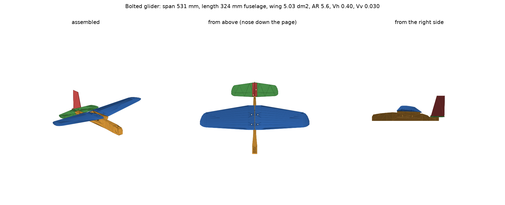

# Bolted glider, 2026-11-10

A larger, multi-part successor to the mk3 glider (`examples/glider.coscad`, 120 mm span).
The wings and body are each as large as one 256 mm plate allows on its diagonal, and
the parts bolt together with M5 screws and nuts. All geometry is CoScad written by
`design.py`. Not printed yet.

| | Value |
| --- | --- |
| Span | 531 mm (two 265 mm panels, 6° dihedral each side) |
| Wing | 120 mm root chord, 66 mm tip, rounded tips, 5.0 dm², aspect ratio 5.6 |
| Section | Clark Y with a truly flat bottom, 8.5% thick at the root, 7% at the tip |
| Fuselage | 324 mm profile (slab) fuselage, 24 mm wide at the nose, 14 at the wing, 9 at the boom |
| Tail | 230 mm ribbed flat-plate stab, 95 mm fin; tail volumes 0.40 (horizontal), 0.030 (vertical) |
| Printed parts | 245 g with hardware: wings 62 g each, fuselage 74 g, stab 16 g, fin 7 g |
| Flying weight | about 296 g with 51 g of nose ballast (281 g / 43 g with nylon tail screws) |
| Print | four plates, 2.5 + 2.3 + 2.3 + 1.5 h |

## Parts and joints

- **Wing panels.** Lofted from the airfoil at seven stations, printed flat side down with
  no supports. The root 31 mm sits on the fuselage's wing saddle. Two M5 x 12 button-head
  screws go down through counterbores (heads 4 mm above the flat bottom) into nuts in the
  saddle. The roots leave a 2 mm gap at the centreline, because with dihedral their top
  edges lean inward.
- **Wing saddle.** Two flanges on top of the fuselage, tilted 6° for dihedral and 2.5°
  for incidence (the stab sits at 0°). Under them are 45° gussets, so the fuselage prints
  standing on its keel with nothing overhanging. The nuts are pushed up into hex channels
  from below; hold each nut in place with a finger until the screw catches.
- **Tail.** The stab sits on a platform at the end of the boom and the fin's foot sits on
  the stab's flat centre block. Two M5 screws (x 14 or x 16) at x = ±6.5 mm clamp both to
  the platform. Their nuts slide into slots from the platform's sides.
- **Stab.** A 0.4 mm skin with a spar at 30% chord, edge rims and Warren-truss diagonals
  on top: about a third of the weight of a hollow airfoil stab. Flat plates make fine
  tails at this size.
- **Fin.** The blade is 2 mm thick at the leading edge, tapering to 1 mm at the trailing
  edge. It prints standing on its foot.
- **Ballast.** Two open pockets on top of the nose (15 mm across, 26 and 30 mm deep,
  9.9 cm³ in all). Fill the front one first, then tape them shut.

## Balance and trim

The balance point should be **35 mm behind the wing root's leading edge** (30% of the
mean chord). That is 10% of the mean chord ahead of the estimated neutral point (40%).
Rest the glider on two fingertips under the wing roots and add ballast until it hangs
level.

| Tail screws | Ballast (lead shot) | Ballast (steel BBs) | Flying weight |
| --- | --- | --- | --- |
| steel M5 | 51 g, fits | 52 g, slightly more than the pockets hold | about 296 g |
| nylon M5 | 43 g, fits | 44 g, fits | about 281 g |

- **Why so much ballast.** Even after lightening, the tail group sits about 150 mm behind
  the balance point. The design already moved the wing 15 mm aft on the fuselage to give
  the ballast more leverage.
- **Flying.** It is heavy for its size: about 59 g/dm² of wing. Estimated glide speed is
  12.5 m/s at a lift coefficient of 0.6, and sink about 1.6 m/s if it glides at 8:1. Expect
  a fast, dart-like glide that needs a firm, level overhand launch. Test over long grass.
- **Trim.** If it dives, add a thin shim (tape or card) under the stab's trailing edge,
  or move a few grams of ballast back. If it stalls and swoops, shim the leading edge or
  add nose weight. If it turns, bend nothing: check the fin is straight and the wings sit
  fully down on the saddle.
- **Root load.** At a 5 g launch each panel carries about 7 N of lift. The root moment
  (0.9 N·m) is held by the panel bearing on the saddle at its inboard edge and the two
  screws, about 35 N each: well within M5 and the plastic around the nuts.

These are standard textbook estimates (Helmbold lift slopes, downwash 2a/(πAR), tail
efficiency 0.9) and the slicer's weights, not measurements.

## Printing

Each part gets mouse-ear pads, modelled as 0.2 mm discs, instead of a slicer brim, since
Bambu's CLI slices no native ears. Every job uses Bambu PLA Basic on the stock 0.20mm
Standard process with no supports, on a textured PEI plate.

| Job | Printer | Part | Settings | Estimate |
| --- | --- | --- | --- | --- |
| `a1-wing-right` | A1 | right wing, on the diagonal | 2 walls, 8% gyroid, 3 top / 2 bottom layers | 2.5 h, 62 g |
| `p1s-wing-left` | P1S | left wing, clear of the excluded corner | same | 2.3 h, 62 g |
| `x1c-fuselage` | X1C | fuselage standing on its keel | 2 walls, 8% gyroid, 3 / 3 | 2.3 h, 74 g |
| `a1-tail` | A1 | stab flat, fin standing | 2 walls, 8% gyroid, 3 / 2 | 1.5 h, 22 g |

- **Flow calibration.** The fuselage runs corner to corner, so start the X1C job with
  `--no-flow-cali`, or its calibration lines at the front get printed over.
- **Checks.** `verify_packages.py` passed for all four: slicer success with no warnings,
  no supports, no brim, inside the plate and the exclusion corner, weight, printer model
  id.
- **Dispatch.** `dispatch.py <job> --spool <name> --confirm-bed-clear
  --authorization-note '...'` sends one verified job and refuses unless the printer is
  idle, fault-free and has the named PLA spool loaded.

## Hardware

- 4 x M5 x 12 button-head screws and 4 M5 nuts (wings)
- 2 x M5 x 14 or x 16 button-head screws and 2 M5 nuts (tail; nylon saves weight)
- about 50 g of lead shot or steel BBs, and tape

## Files

Run in this order: `design.py`; `coscad stl NAME.coscad -o NAME.stl` for the five parts
and their `ears-NAME.coscad`; `verify.py` (fit and aerodynamics: `validation.json`,
`preview.png`); `prepare_slice.py`, `slice.py`, `verify_packages.py`; then `balance.py`
(`balance.json`). Python 3.13 with trimesh, manifold3d, scipy and matplotlib. The
part placement in flight is in `assembly.py`.
