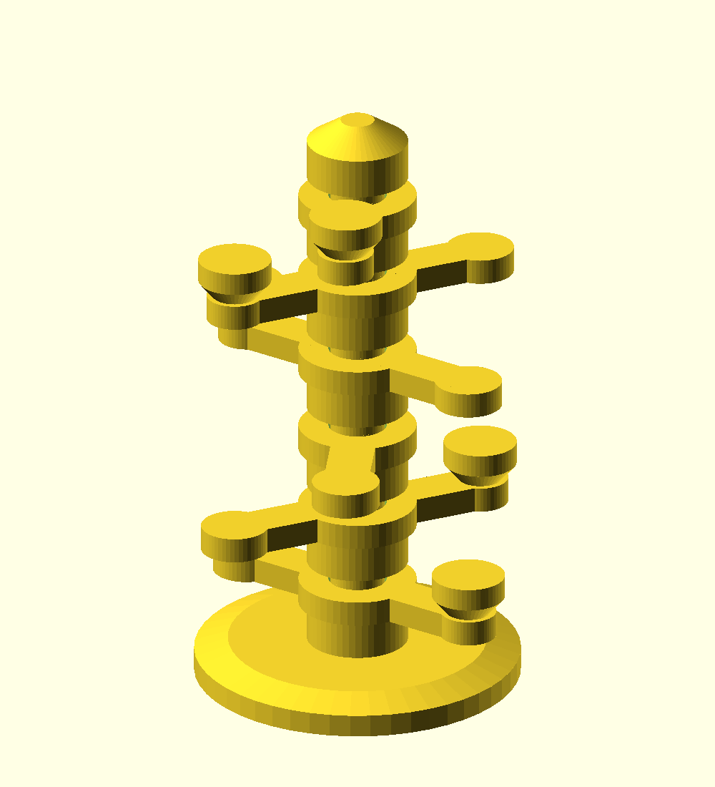

# Orbit Tower

A 20-piece desktop construction kit made entirely in CoScad. Six independent
arms spin around a stacking central tower. Each arm carries a removable
satellite. Assemble it by hand, play with the spiral arrangement, and take
it apart again.



Finished height: 107 mm. Base: 58 mm diameter. Maximum rotating diameter:
61 mm. Twenty pieces fit on one 256 x 256 mm A1 bed with a 7 mm margin.

## Pieces

| Piece | Quantity | Recognise it by |
| --- | ---: | --- |
| Base | 1 | Large round foot with square peg |
| Axle | 6 | Small round pedestal, square socket below and peg above |
| Rotor | 6 | Long flat arm with centre hole and one small end hole |
| Satellite | 6 | Mushroom shape with a small round peg |
| Top cap | 1 | Tapered finial with square socket below |

## Put it together

1. Put the base on a table, square peg up.
2. Lower an axle onto the base peg, with its socket facing down.
3. Slide a rotor over that axle's square peg and onto the round journal.
   Its centre should sit on the round shoulder and turn freely.
4. Turn a satellite peg-down and insert it in the small hole at the end
   of the rotor. The opposite end is the integral counterweight.
5. Add the next axle onto the square peg. It captures the rotor below.
   Repeat with all six axle/rotor/satellite sets.
6. Fit the tapered cap on the last square peg. Fan the arms into a spiral
   or spin them individually.

The joints are loose gravity fits. Lift the assembled toy by its base.

## Clearances

- Stacking peg: 6.0 mm square; socket: 6.6 mm square (0.3 mm per side).
- Exposed peg length: 5.0 mm; socket depth: 5.6 mm.
- Journal: 9.6 mm diameter; rotor bore: 10.4 mm (0.4 mm radial gap).
- Satellite peg: 4.8 mm diameter; hole: 5.5 mm (0.35 mm radial gap).
- Satellite insertion: 3.8 mm into a 4.5 mm through hole.
- Space above each rotor: 3.5 mm; satellite tops clear the next rotor
  vertically by 3.5 mm throughout rotation.

Square and round peg entries are bevelled. Parts print broad face down;
small 6.6 mm socket roofs bridge without separate support material. The
actual ease of fit and spinning still needs checking on the printed kit.

## Build and check

From the CoScad repository root:

```sh
stack exec coscad -- doctor
stack exec coscad -- check models/orbit-tower/orbit-tower.assemble
stack exec coscad -- next models/orbit-tower/orbit-tower.assemble
python3 models/orbit-tower/verify.py
python3 scripts/bambu-slice.py models/orbit-tower/orbit-tower_manifest.json --printer 'Bambu Lab A1 0.4 nozzle' --slicer-arg=--wall-loops --slicer-arg=3
```

The six identical axles have separate names in the assembly so the
interference checker treats their touching shoulders as separate physical
parts, rather than merging their meshes and mistaking sealed socket air
spaces for solid components. All six read the same axle.coscad source.

Checks include closed meshes, 20 disconnected packed pieces, one bed,
bed bounds, volume conservation, assembled interference, nominal joint
clearance and deliberately shifted interference probes, and a conservative full-rotation
swept-envelope check (excluding the intentional bearing contact face). See validation.json. No compiler code was changed.

Print profile: A1, 0.4 mm nozzle, 0.20 mm Standard, three perimeter walls,
PLA Basic, textured PEI, supports off. Print dispatch and observed startup
are recorded in print-run.json; those alone do not prove completion.

Slicer estimate: 1h 30m 16s model printing; approximately 1h37m
including preparation. Material: 39.66 g. Yellow PLA from AMS
slot 3. The model has 100 layers and all 20 pieces are printed together.

On 2026-10-11 the A1 accepted the kit and reached layer 2/100 at 15%,
with print_error 0 and 82 minutes remaining. The first layer completed
according to printer telemetry. The camera angle obscures much of the bed,
so adhesion of all twenty pieces could not be visually confirmed. Print
completion and actual assembly fit remain unverified.
