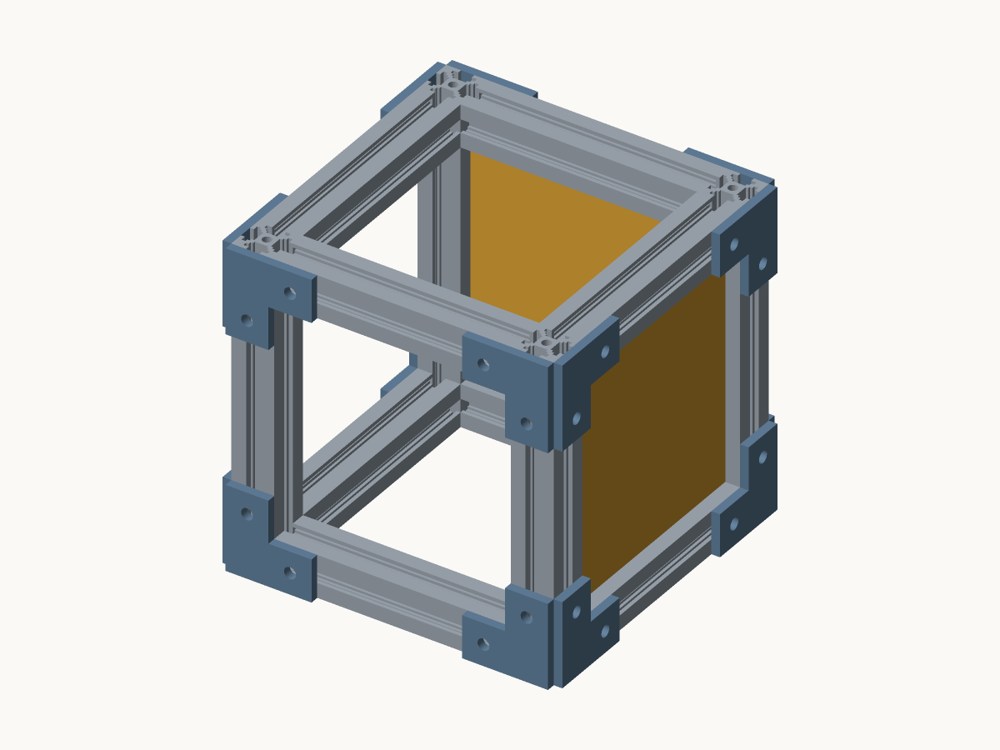

# Panel-braced cube: removable-panel racking experiment

A **150 x 150 x 150 mm** printed-2020 frame, with a removable back panel and
right-side panel. The brackets extend the overall envelope to **158 x 158 x 150 mm**.
This scales the successful small-tank panel's mating profile to a longer span
without scaling the 20 mm rails, fasteners or slot clearances.



## Three configurations, one frame

| Specimen | Panels | Purpose |
| --- | --- | --- |
| `bare.assemble` | None | Baseline frame and bolted-joint movement |
| `back.assemble` | Back | First panel's effect on sideways movement and twist |
| `back-side.assemble` | Back and right side | Effect of a second perpendicular panel |

All three contain exactly the same twelve rails, sixteen brackets and 32 M5 joints.
The 120 x 120 mm panels have a 5.7 mm neck, bilateral 10.5 mm stepped heads,
0.25 mm clearance per contacting face and 3 mm insertion ramps. Only the two
edges parallel to insertion have heads; the top and bottom tongues pass through
the rail mouths. There is **no floor panel**, so it cannot confound the bracing
comparison. The front, left, top and bottom remain open.

These are geometric and manufacturing prototypes. The 70 mm parent wall's good
physical result is owner-reported; the larger panels, frame stiffness, printed
slot lips and assembled load capacity have not been physically tested.

## Full two-panel kit

| Part | Count | Notes |
| --- | ---: | --- |
| 2020 upright, 150 mm | 4 | Unchanged tank rail cross-section |
| 2020 cross rail, 110 mm | 8 | Fit between the full-height uprights |
| Flat 40 x 40 x 4 mm L bracket | 16 | Existing tank bracket, unchanged |
| Bilateral 120 x 120 mm panel | 2 | Identical back and side parts |
| M5 x 8 bolts | 32 | Externally supplied |
| Slot-6 M5 T-nuts | 32 | Externally supplied; check actual fit in an existing rail |

Do not mix the earlier shelf's widened slot profile into this kit: these panel
heads match the **tank's** 6.2/11/8.4 mm stepped slot. The rail length changes,
but its cross-section and the bracket holes do not. No rail splices are required.

## Assembly and panel changes

Build the bare frame with all brackets and top rails installed. Insert the T-nuts
from open rail ends before closing any end that would trap them. The planner
describes every M5 joint and the panel-before-cap dependencies.

To add or remove the back panel, release its top-back rail and the brackets that
retain it, slide the panel axially down or up the upright slots, then reinstall
the rail and brackets. Use the corresponding top-right rail for the side panel.
The other panel can stay in place. **Always reinstall both top rails and all
fasteners before measuring any configuration**, including the bare frame.

The normal 0.25 mm clearance deliberately permits some initial movement; a
captured sliding panel is not an adhesive bond. This experiment determines how
much bracing it actually provides after clearance is taken up.

## Printing preparation

`manufacture.assemble` contains the full **30-part** kit in explicit print poses.
Rails print vertically and panels upright along their insertion direction.
Both include integral 0.20 mm mouse ears; trim them flush before assembly. The
brackets print flat. No modeled underside above the bed exceeds 45 degrees.

The native packer produces **two generic 256 mm beds**. These are **not sliced
or printer-specific dispatch packages**. In particular, the generic packing
starts near the plate corner and has not checked the X1C/P1S exclusion area or
calibration lines. Repack and verify the actual printer's plate, temperatures,
material, paths and upload before printing; no print is started by these scripts.

The manifest retains small-contact/tall-narrow warnings for rails and panels.
Mouse ears do not establish adhesion at this new size. For a first physical
trial, use the successful panel's precision settings (0.10 mm, first 0.20 mm,
four walls, solid panels), print the rails upright, and review acceleration,
ears and spacing in a printer-specific slice. Rail infill must be recorded so
test results remain comparable.

## Repeatable physical test

1. Fix the bottom frame to a bench at the same points for every measurement.
   Mark a load point on the top-front-right upright at 140 mm above the bench.
   Record filament, print settings, clamp locations, bolt tightening and gauge
   resolution; mark bolt positions to make cap reassembly repeatable.
   A fixed dial indicator or caliper resolving about 0.01 mm is preferable to a
   ruler. The planner's torque suggestions are defaults, not measured limits
   for these printed slot lips.
2. Use a force gauge to apply **0.5, 1 and 2 N horizontally**, first along X,
   then Y. Measure displacement at that marked point relative to the bench.
   If possible, also measure the opposite top corner to distinguish twist.
3. For each force, record loading displacement, displacement while unloading
   to the same force, and residual displacement after returning to zero. Repeat
   three times. Record any joint slip or visible damage rather than treating
   it as elastic panel deflection.
4. Run **bare → back → back-and-side → bare again**, with all caps reinstalled
   each time. The repeated baseline exposes changes from settling or reassembly.
   `measurements.csv` is an empty recording template, not fabricated test data.

Evidence of useful bracing is a repeatable reduction in movement beyond the
measurement scatter, without increased permanent offset. Do not assume a target
stiffness increase in advance. Report initial free play separately from the
stiffer response after contact, and compare both loading directions.

The current perfectly bonded FEA experiment cannot represent these sliding,
gapped interfaces directly. Use the measurements to guide a later compliant or
contact model; no bonded-cube strength claim is made here.

## Reproduction and evidence

Use the analysis packages pinned in `../tank-model-2020/panel-fit-v2/README.md`:

```sh
python prepare.py
../../bin/coscad next manufacture.assemble
../../bin/coscad site site bare.assemble back.assemble back-side.assemble
python verify.py
```

`prepare.py` generates standalone CoScad parts and the three assembly sources
from the existing tested profiles, then renders the parts with the native
backend. `model.json` records the parent hashes and BOM. `validation.json`
records actual assembly checks, identical frame poses, all print-mesh checks,
panel insertion sweeps and overtravel controls. The site contains local build
instructions; it is not deployed to the public manual automatically.

### Local validation result

All three assemblies passed validation and native mesh checking with **zero
overlaps and zero clearance warnings**. Their plans have **28, 29 and 30 steps**,
three flips each, every physical part placed once and all **32 M5x8 bolts**
driven. Panel drop joints are recorded separately from those bolts. Every panel
precedes its matching cap rail. The two 321-position insertion sweeps both had
zero overlap with the rest of the specimen, including the perpendicular panel.
Overtravel beyond the nominal normal clearance collides on both faces, confirming
capture rather than a missing mating feature.

The seven standalone part meshes render natively. All four print variants are
closed single components with no above-bed downward face steeper than 45 degrees.
The manufacturing manifest contains all 30 parts on two generic beds, retaining
its adhesion/height warnings. None of this establishes physical stiffness or a
printer-specific successful slice.

### Upright previews

`Preview.hs` uses the existing native image renderer with each physical component
as a separate scene object, so all three previews share the same upright view.
From the repository root, build it with:

```sh
cabal exec -- ghc -package coscad models/panel-braced-cube/Preview.hs -o /private/tmp/cube-preview
cd models/panel-braced-cube
/private/tmp/cube-preview
```

The separate-instance path also avoids a current limitation reproduced by
`coscad back-side.assemble`: its optional fused assembly preview warns
`indexed import changed volume; near-coincident operand is unresolved` while
trying to boolean-union touching components. That fused preview is not used
here. The individual print meshes, instance-based build-plan images and actual
assembly interference checks succeeded. This renderer warning is not physical
evidence of an assembly defect, and has not been fixed in the compiler by this
model addition.

## P1S and A1 print trial, 2026-11-09

The owner requested one bed on each printer and explicitly confirmed both plates
clear. `prepare_print.py` repacks the complete kit into printer-specific projects;
it does not reuse the generic corner-start layouts above.

| Printer / job folder | Contents | Final process | Slicer estimate |
| --- | --- | --- | --- |
| `p1s-panels-brackets-20261109` | 2 upright panels, 8 flat brackets | 0.20 mm, 4 walls, 100% infill | 15 h 8 min, 254.78 g |
| `a1-rails-brackets-20261109` | 4 upright 150 mm rails, 8 upright 110 mm rails, 8 flat brackets | 0.20 mm, 4 walls, 25% gyroid | 46 h 44 min, 367.69 g |

Both use a 0.20 mm first layer, integral mouse ears, no additional full brim,
no supports, 220 C nozzle and **55 C textured PEI bed**. Outer/inner wall speeds
are 40/70 mm/s; default/outer-wall acceleration is 2000/1000 mm/s², travel
180 mm/s at 3000 mm/s². These actual settings supersede the suggested 0.10 mm
first-trial recipe above. The initial unstarted, slower slices were replaced
before any dispatch: their estimates were 36/58 hours.

The P1S uses its reported loaded external yellow PLA. The A1 uses **white PLA
in physical AMS slot 1 (`ams0`, mapping `[0]`)**, avoiding the yellow slot 3.
The bracket infill differs between the two beds: label their origins and keep
every bracket in the same position for all three test configurations, so this
does not become an unrecorded change during the bracing comparison.

`verify_print.py` checks the exact expected quantities and per-object layer
coverage, source/STL identities, exported mesh poses and topology, motion settings,
all model extrusion paths inside a central safe region, plate/printer identity,
and actual bed/nozzle commands throughout the print. P1S has 600 layers and A1
750; every shorter part must also finish all its own layers. The shared audit
retains its X1C defaults for old callers and rejects wrong-printer packages.

`print_job.py p1s` or `print_job.py a1` reads status. With `--start --bed-clear`,
it repeats verification and uses the existing one-shot tank LAN dispatcher,
full remote SHA-256 read-back, exclusive run record, and fresh printer/spool
checks. **Never resend a job with a dispatch record**, including after an
uncertain acknowledgement. The per-job `print-run.json` distinguishes acceptance,
startup observations and first-layer telemetry. Print completion, physical
quality and the stiffness test require later evidence.

Both one-shot starts were acknowledged SUCCESS after full remote-content hash
verification on 2026-11-09. The P1S job is
`cube-p1s-panels-brackets-20261109-20261109-223916.gcode.3mf`; its verified package
SHA-256 is `36a58dd9472423bf435aa1355414ab56d0dd9a745d3692ed25a7728029852448`.
The A1 job is `cube-a1-rails-brackets-20261109-20261109-224110.gcode.3mf`, SHA-256
`cfb08853c063ff6b0d571f38211cf3222945a721f20d4dd604b91c56ea5e8556`.

During P1S startup, HMS `0300-3100-0001-0001` was reported around 22:42–22:44
Sydney time, then cleared by 22:44:30 without any alert-clear command.
The local dashboard's code catalogue labels this as fan-related; the same code
was recorded during the earlier threaded-globe run. The printer kept RUNNING
with print_error=0. This is a transient reported alert, not proof that the fan
or its previously suspected connector is repaired. Startup telemetry, including
any later recurrence, remains in the run records.
