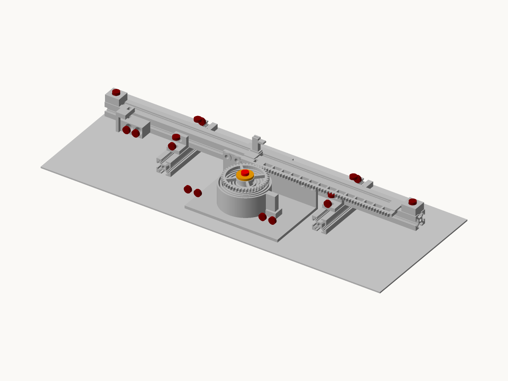

# Spiral spring launcher (2026-11-16, revision 2 2026-11-17)

A follow-up to the captive spring demonstrator (`../captive-spring-demo`). A
printed PLA spiral (clock) spring drives a pinion, and the pinion drives a rack
carriage that throws the 10 g glider from `../pla-bow-launcher`. It winds about
**1.04 turns** over a 180 mm pull, where the demonstrator wound 0.04 turns
over 10 mm.

**Revision 2** keeps the spring and gearing and rebuilds everything else:
- **Structure:** printed 2020 extrusion, the same slot-6 profile as
  `../tank-model-2020`.
- **Hardware:** only **M5×10** screws, M5 drop-in T-nuts and one M5 hex nut.

**Result (model only, revision 2 not printed or tested):**
- **Speed:** 8.3 m/s for the 10 g glider at 24.8 MPa peak strip stress,
  including a 0.85 efficiency deduction. Revision 1 gave 8.6 m/s; the 2.4 g
  heavier carriage (T-key shoes, printed mast) costs the difference.
- **Energy:** 1.51 J stored.
- **Draw:** 16.8 N at full draw.

## Why it doesn't coil more

The spring spins as it releases. Its inertia, seen at the carriage through a
pinion of pitch radius R, acts like a mass of J/R² riding on the carriage.
Winding more turns over the same stroke means a smaller R, and that effective
mass grows quickly. Best designs from `study.sol` (strip ≤ 75 g, 180 mm
stroke, 13.2 g carriage):

| Turns wound | Best speed | Spring + pinion felt at the rack |
|---|---|---|
| 0.5–1.0 | 8.2 m/s | 13 g |
| 1.0–1.5 | 8.3 m/s | 14 g (this design) |
| 1.5–2.0 | 6.4 m/s | 32 g |
| 2.0–3.0 | 3.5 m/s | 111 g |

So the design keeps the spiral compact and puts a large, light pinion on it:
- **Spiral:** 7 coils inside 70 mm, from a thick (2.0 mm), tall (28 mm) strip.
- **Pinion:** a spoked module-1.25, 44-tooth ring.

## Files

- `study.sol`: sizing model and the trade table above (about 1 minute).
- `build.sol`: writes every part and four assemblies:
  - `launcher.assemble`: full draw, stopper in, glider loaded.
  - `launcher-end.assemble`: end of the stroke, with the last rack tooth at
    the pinion.
  - `launcher-coast.assemble`: the carriage at the front stop, glider 100 mm on.
  - `spiral-launcher-build.assemble`: the build plan input (`coscad plan`).
    Published with renders at
    https://manual.cswine.cloud/builds/spiral-launcher-build/.
- The glider parts come from `../pla-bow-launcher`; the feet are
  `../tank-model-2020/rail100.coscad` itself.
- `print/` holds the revision 1 print records (2026-11-16). They do not match
  these sources.

Run both scripts from the repository root or this folder, e.g.
`"$SOL" models/spiral-launcher/build.sol`.

## Design

| Part | Count | What it is |
|---|---|---|
| `beam221` | 2 | 2020 rail, 221 mm, the tank model's profile. Joined end to end at x −6 as the track; the carriage rides the top slot |
| `rail100` (tank model) | 2 | The tank model's 100 mm rails, reused as cross feet, one under each beam's centre |
| `corner-bracket` | 4 | Beam side face to foot top, 5 mm thick, one M5×10 per leg |
| `splice` | 1 | Plate across the beam joint on the +y faces, 4 × M5×10 |
| `base` | 1 | Plate on the bench under the spring, with a flange bolted to the beams' −y faces (4 × M5×10). Arbor post (12 mm) with a slide-in M5 nut, clamp pocket for the spring's outer block, hub washer |
| `spring` | 1 | Counter-clockwise spiral, 2.0 × 28 mm strip, 924 mm long, centreline r 8–34 mm. Hub turns on the post (12.5 mm bore) and has a collar the pinion rests on and a 16 mm hex boss that keys it. The clamp block drops into the base's pocket: no screws |
| `pinion` | 1 | Spoked ring gear, module 1.25, 44 teeth, R 27.5, 4 mm face, hex hole |
| `cap` | 1 | Disc on the post top, one M5×10 into the post's nut; 0.3 mm axial play for the hub and pinion |
| `carriage` | 1 | Rack bar (215 mm, lightening windows, stopper notch), backed by the beam face 0.3 mm away, with two shoes whose T-keys run in the beam's top slot. Prints flat on its bottom |
| `mast` | 1 | Glider mast and printed pin (6 × 2.9 mm bar, 8 mm long), pushed into the rear shoe's socket (a drop of glue). Prints lying on its side so the pin is on the bed |
| `stop` | 2 | End stops on the beam top, one M5×10 each, key necks clear of the T-nut. Foam tape on the front one's face |
| `stopper-guide` | 1 | C-shaped guide on the beams' −y face around the rack's path, 2 × M5×10 |
| `stopper` | 1 | Plate dropped through the guide into the rack's notch and the guide's lower pocket |

**Hardware:** 21 × M5×10 button head screws, 20 × M5 drop-in T-nuts (2020,
slot 6), and 1 × M5 hex nut (in the arbor post).

How it runs:
- **Winding:** pulling the carriage back (−x) turns the pinion
  counter-clockwise, which tightens the spiral.
- **Release:** at the end of the stroke the rack's last tooth leaves the
  pinion. The spring and pinion free-spin instead of being stopped through the
  teeth. The carriage coasts 5 mm into the front stop, and the glider slides
  forward off the pin.

**To launch:**
1. Pull the carriage back to the rear stop.
2. Drop the stopper through the guide.
3. Load the glider.
4. Lift the stopper.

## Build plan

`coscad plan spiral-launcher-build.assemble`: 19 steps, no flips. The T-nut
positions in the preload sheet are the real holes (`at=` from each rail's
marked end). In short:
1. Slide the hex nut into the arbor post's side slot.
2. Each beam on its foot, T-nuts in, then the rear stop and corner brackets.
3. Splice the beams.
4. Base flange onto the beams; spring onto the post.
5. Stopper guide.
6. Slide the carriage in from the front end, then the front stop.
7. Mast into the carriage.
8. Pinion onto the hex boss, meshing with the rack.
9. Cap and its screw.

Two things in the plan input are worth knowing:
- **Base preloaded by hand (a workaround):** the post's nut slides in from
  the side. The planner reads a framed nut pocket as opening along its
  bearing normal (down onto the bench), so the plan says to load it in hand
  before the base goes down.
- **Feet under the beam centres (a real design choice):** each beam balances
  on its foot while it is built, and the base plate carries the middle.

## Checks done

- **Renders:** every part renders with the native backend.
- **Interference:** `coscad check` finds 0 overlaps at the end of the
  stroke, with the glider loaded.
  - Shoes on the beam top: contact.
  - Key head under the slot lips: 0.2 mm.
  - Rack bar to beam face: 0.3 mm.
  - Rack to pinion: 0.14 mm.
  - Rack bar to base flange: 0.6 mm.
  - At full draw, the carriage clears the guide by 0.4 mm and the stopper
    sits 0.2 mm from each side of the notch.
- **The one overlap at full draw and coast** is a modelling artefact. There
  the pinion is turned (375° and −6°) but the spring is drawn in its rest
  pose, so its hex boss no longer lines up with the pinion's hex hole. A
  wound spiral can't be drawn as a rigid part.
- **Overdraw stop:** 1 mm behind the carriage at full draw.
- **The assembled-view PNG** from `coscad launcher.assemble` fails
  (near-coincident faces where parts rest on each other). `built.png` is the
  plan's last step render instead.

## Not checked

- **The spring model:** it uses pure moment and assumes the wound coils
  tighten evenly (1.2 mm wound gap). The clamp and hub ends carry stress
  concentrations, coils may rub, and stiffness depends on the real PLA (as on
  the bow launcher).
- **Inertia:** the effective mass assumes each strip element turns by
  θ(L−s)/L about the arbor.
- **Sliding:** the T-keys run in a printed slot whose layer lines cross the
  direction of travel, and the rack bar may bear on the beam face. Friction is
  inside the flat 0.85 efficiency only by assumption. The keys cross the beam
  joint, so the splice must line the slots up.
- **The hub on the post:** PLA on PLA, turning about one revolution at speed
  per launch.
- **Drop-in T-nuts in the printed slot:** the tank model used them; the
  owner's nuts have not been measured against this profile.
- **Re-engaging the rack:** after a launch the pinion stops at an arbitrary
  angle, and pulling the carriage back has to find the mesh. The teeth have no
  lead-in chamfer yet.
- **The mast's push fit:** it takes the end-of-stroke shock; glue it.
- **The glider's nose trim:** the glider still carries its 1 g M3 screw as
  ballast. That is part of the glider, not the launcher.

## Revision 1 (printed 2026-11-16)

A printed rail with a hold-down lip, a base with legs, M3/M4 screws and an
M5×50 axle. Planning it found three faults in the printed parts: the pinion
had no shoulder, the clamp block sat over a 1 mm gap, and the bolt-head
pockets were too shallow. Revision 2 replaces those parts. See the git
history (7ba2966, 28e8b35) for its sources.
