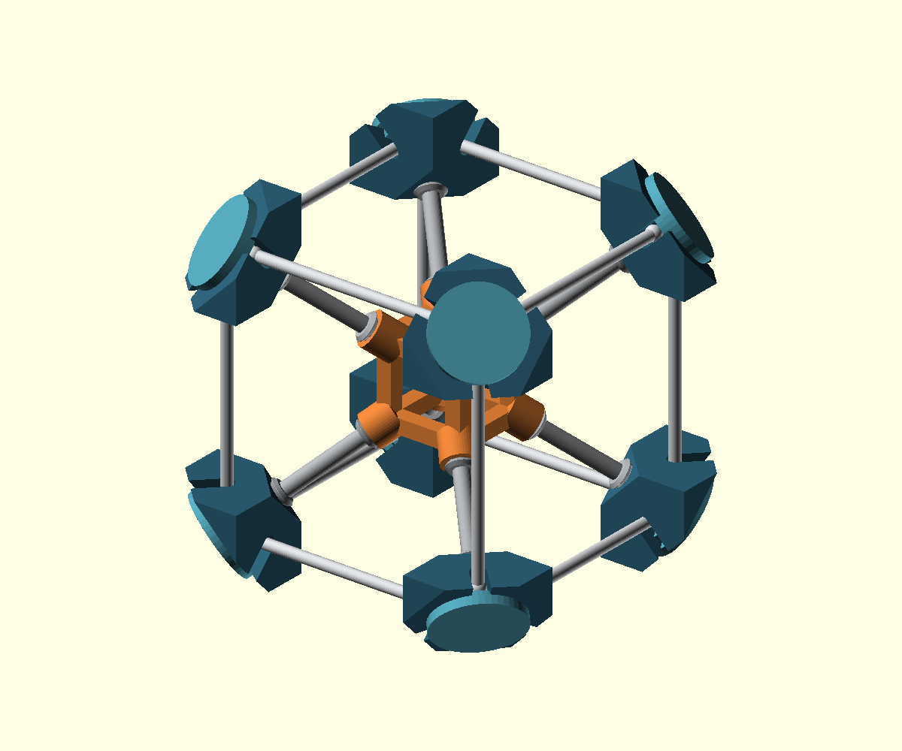

# Tesseract III: directly threaded joints

A new, deliberately larger mechanical prototype: a 120 mm outer corner-centre
cube around a 40 mm open inner frame, with eight radial struts. The corner
bodies extend the overall envelope to about 160 mm. There are **37 printed
parts**, with no purchased bolts, nuts, glue or press-fit pins:

| Part | Quantity | Connection |
|---|---:|---|
| Open inner frame with corner bosses | 1 | Eight internal threads |
| Diagonal strut with seating shoulders | 8 | Integral male thread at each end |
| Open corner hub | 8 | Internal rear socket and cap socket |
| Screw-on corner cap | 8 | Integral male screw; broad retaining face |
| Collared edge bar | 12 | Drops into two open hubs; captured by caps |



## Latest owner observations — 28 October 2026

The corrected **split Bed 1 is printing well on the P1S**, according to the
owner. This is progress in the current print, with completion not yet reported;
see [the progress record](p1s-split-retry/bed1/physical-progress-20261028.json).
The owner also confirms that the [previous fastener-free tesseract](../../examples/assemble/tesseract/README.md)
**printed well on the A1**. The initial one-bed failures of this newer design
remain puzzling. The known 35°C slicing mistake may have contributed, but the
successful progress after several simultaneous changes does not isolate a cause.

## P1S failure and A1 retry

The full P1S attempt failed early: the owner reported loss of adhesion and
spaghetti in several places, and the printer later reported FAILED at layer
5/496. The cause is unknown. The photo and unconfirmed bed/Z-motion hypotheses
are preserved in [the failure record](p1s-full/physical-failure-20261028.json).
The owner requested [an A1 retry](a1-full-retry/README.md), using white PLA in
physical AMS slot 1 instead of yellow PLA in slot 3, and confirmed its bed clear.
The successful screw/socket coupon does not establish full-plate reliability.

## Confirmed slicing mistake; corrected retry restarted after bed cleaning

A shared error was found in the custom export workflow: the failed P1S and A1
G-code selected Cool Plate and heated to 35°C despite the intended Textured PEI
profile at 55°C. This could have contributed to both adhesion failures; it does
not prove that it was the only cause. [Evidence and correction](slicing-plate-mismatch-20261028.json).
The first split-plate retry was stopped at layer 1 to correct the same issue.
The corrected 55°C package was initially held at the owner’s request. The owner
later cleaned the P1S bed and requested a restart on 28 October 2026. Fresh
preflight and upload checks passed; the P1S accepted the new first-plate job and
reached layer 1/78 at 17:44:24 Sydney time with a 55°C bed target, 220°C nozzle
target and no active faults. A transient startup fan warning cleared. The owner
has since reported good printing progress; completion remains unreported.

## Latest: split plates after both full-plate failures

The owner reports that the A1 attempt also failed early. The cause remains
unknown; recent unrelated prints worked well. The [revised five-plate setup](p1s-split-retry/README.md)
separates irregular/tall parts, adds 8 mm brims to every object, keeps geometry
away from the edges and slows the first layer. Plate 1 contains eight broad, flat caps; its first attempt was stopped to
correct the plate-profile error above; the corrected retry was subsequently
restarted after the owner cleaned the bed. The other layouts are prepared
for later tests. This does not establish a diagnosis or a physical fix yet.

## Why this can be assembled

Screwing rigid bars into both ends of an already closed cube creates an assembly
trap. This version keeps the edge bars stationary: screw each strut into the
inner frame, rotate an empty corner hub onto the other end, drop the edge bars
into the open hub channels, then screw each cap down independently. The caps'
central screws enter the hubs without crossing the bar ends. Their broad lower
lands close the insertion channels and retain the bars' integral spherical ends.
No completed cube section has to spin to close the final edge.

The threads are custom coarse right-hand profiles, not ISO hardware threads:
10 mm nominal major diameter, 3 mm pitch and 8 mm nominal engagement. The female
profile adds 0.35 mm radial and 0.18 mm axial flank clearance. Those are initial
PLA clearances. **The owner reported that the P1S screw/socket coupon worked
on 28 October 2026**, recorded in `physical-thread-fit-20261028.json`. The full
hub/strut/boss interfaces remain a new physical assembly test. Start by hand;
do not force a binding screw.

Hold the inner frame with a temporary cradle or a helper while adding struts
and hubs. Seat each strut's shoulder against its boss. Clock each empty hub so
its three edge channels face the neighbouring hubs. Assemble all twelve bars
before closing the caps. Seat caps finger-tight. Do not over-tighten to obtain
an exact rotational phase: real shrinkage, friction and shoulder alignment still
need physical checking during this first full assembly. This is a display-model prototype,
not a structural load rating.

## Pure CoScad and stable references

`design.coscad` is the hand-authored geometry source. The coarse helix is built
from a small hull facet and repeated CoScad transforms; it imports no SCAD or
mesh and needs no geometry-generating Python. `export.py` merely selects named
CoScad definitions as `main` in standalone part files. Edit the master and rerun
that selector rather than editing the copies.

Features use named frames saved on the original corner and inner-frame blanks.
`place` locates bar ends and seating shoulders; `mate` locates threaded tools,
bosses and caps. The assembled `tesseract.assemble` fixes only the inner frame;
all other poses come from mates, including redundant bar connections that check
the cube's closed loops. Helix pitch offsets and channel-opening directions are
local feature dimensions, not a list of absolute assembled coordinates.

The compiler's rigid mates describe the final assembled pose. They do not model
screw kinematics or generate a threaded assembly procedure. The sampled motion
checks and the manual order above are separate evidence; `coscad plan` is not
claimed to understand these threaded joints.

## Verification

`validation.json` records:

- One connected, watertight, consistently wound mesh per rigid part.
- All 666 assembled part pairs below a 0.01 mm³ interference threshold.
- 121 cap screw/removal poses against the other assembled components.
- 792 bar insertion samples, with other bars present and caps absent.
- 73 positions each for coupon screwing, strut removal and hub removal.
- Negative controls: a cap rotated half a turn without matching axial movement
  collides with its thread, and a closed cap obstructs an outward bar pull.

The native `coscad check` also passes with **0 overlaps and 0 clearance warnings**.
These are sampled geometric checks, not a continuous-motion proof or a physical
fit/strength test. Small numerical residuals are reported rather than rounded
into a claim of exact zero. During development a cutter ended exactly on the
hub's top plane, producing degenerate faces. Extending it 0.2 mm past that plane
removed the degeneracy and restored native-backend rendering; no mesh repair or
warning override is used.

## First physical trial

`thread-fit.assemble` contains one screw and one through-bored female coupon,
using the same male/female definitions as the full model. The through-bore avoids
an unnecessary blind-floor printability warning and lets debris escape. It tests
the thread profile; the full model's blind-socket depth is checked geometrically.
The screw prints broad head down, and the socket prints upright. Both fit on one
small plate without supports. The verified X1C package uses 3.24 g PLA: about
12 minutes of sliced print time, or 21 minutes including startup overhead.
It has 55 layers and no support paths. Settings, extrusion endpoints and the
package hash are recorded in `thread-fit-validation.json`. This is a future test only;
**the X1C coupon was not dispatched**. The separate P1S coupon was printed and
reported successful by the owner.

The complete 37-piece [P1S manufacturing project](p1s-full/README.md) now fits
one plate. It uses small flats on the bars' tips for upright adhesion, per-object
brims, and bed-only trees on the inner frame with thread-bore support exclusions.
Its actual exported geometry, toolpaths and support roots are checked in
`p1s-full/package-validation.json`. The estimate is 19 h 49 min and 309.4 g PLA.
The owner authorized proceeding on a clear P1S bed; actual dispatch/startup state
is recorded in `p1s-full/full-print-run.json`. The full assembly's physical fit
and print quality are not established by the successful coupon.

## P1S physical thread trial

The owner requested a P1S thread-fit print on 28 October and confirmed a clear
bed. A separate [P1S slice and dispatch record](p1s-thread-fit/README.md) preserves
the X1C preparation above. It uses the loaded external PLA, no supports and a
5 mm brim; estimated material is 3.01 g and total time about 18 minutes. See its
record for actual startup status. The owner subsequently reported that the
thread fit worked; the complete assembly remains unverified.

## Reproduce

From the repository root, with the pinned native kernel available:

```sh
export PKG_CONFIG_PATH="$PWD/.native/manifold-3.5.2/install/lib/pkgconfig"
cabal build exe:coscad
COSCAD=$(cabal list-bin exe:coscad)
python3 models/tesseract-v3-threaded/export.py
python3 models/tesseract-v3-threaded/verify.py --coscad "$COSCAD"
"$COSCAD" check models/tesseract-v3-threaded/tesseract.assemble --backend=native
"$COSCAD" next models/tesseract-v3-threaded/thread-fit.assemble --backend=native
python3 models/tesseract-v3-threaded/center_coupon.py
python3 scripts/bambu-slice.py models/tesseract-v3-threaded/thread-fit_manifest.json --printer 'Bambu Lab X1 Carbon 0.4 nozzle' --filament 'Generic PLA' --process-overrides models/tesseract-v3-threaded/coupon-process.json
```

The verifier needs numpy, trimesh and manifold3d (available in the existing
modelling environment). After regenerating the coupon bed, center its two parts
before slicing for X1C so the brim clears the front-left exclusion. The saved
manifest describes the actual centered plate. `preview.scad` is visualization
only: it imports the CoScad-compiled meshes using compiler-resolved poses.
