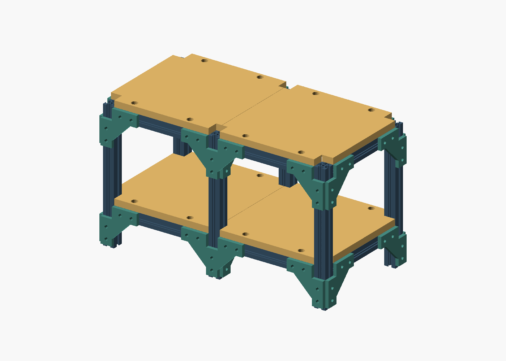
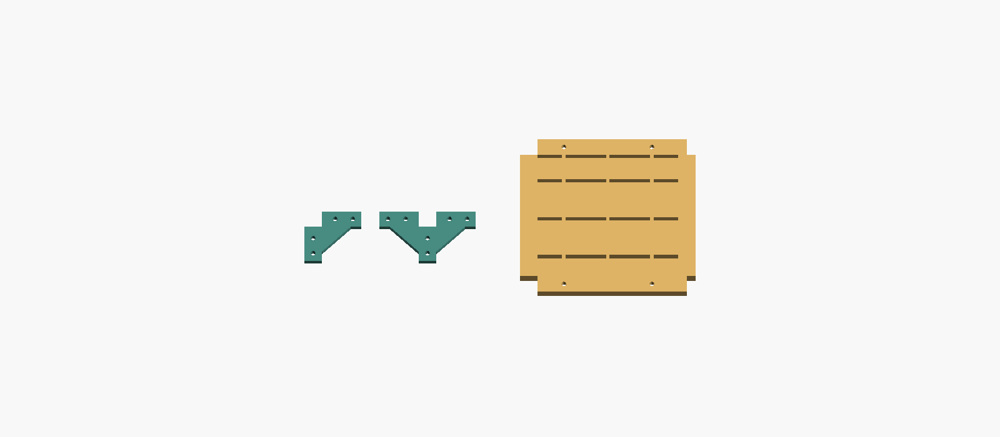

# Two-tier printed 2020 shelf

Desktop prototype for **1 kg of light, distributed objects per tier**. Four
nominal 200 × 200 mm panels form two approximately 400 × 200 mm decks. Every
structural part is PLA; only the M5 bolts and sliding T-nuts are external hardware.
The fit test was dispatched to the X1C on 27 October 2026 using the loaded external
PLA, after the owner confirmed the bed clear. The full shelf has not been dispatched.
The load target and actual hardware fit have not been physically verified.
The local `fit_run.json` records upload verification, the single start command,
acknowledgement and startup observations.



## Physical fit result and upright retry — 28 October 2026

The owner reports that the first three-piece print completed and two of the three
items were decent. The horizontally printed T-slot rail had defects in its upper
lips. This is a print-quality observation, not a verified nut-fit or load test.
The original trial files are retained for comparison.

The new [upright retry](vertical-retry/README.md) prints only the same 50 mm rail,
with its length along Z, six walls, a 5 mm brim and no supports. All four slot
profiles run continuously up the layers. The earlier horizontal full-shelf
toolpaths are superseded as the intended manufacturing approach: do not dispatch
them unchanged. Repack and re-slice the full rails upright after this fit test;
the eleven-plate estimates below describe the old horizontal layout. Vertical
printing changes layer orientation and still needs a separate load test.

The owner subsequently reported that the upright rail printed well but the nuts
were very tight. The [looser upright trial](vertical-loose-fit/README.md) widens
the nut pocket and opening while preserving the outer size and lip thickness.

## Dimensions and construction

- Deck tops: 81 and 241 mm above the feet. Overall envelope with outside
  connectors: approximately 412 × 212 × 241 mm.
- Clear height below the upper rails: 129 mm; the gussets reduce this locally
  near the posts. The tier spacing is 160 mm, chosen to keep each upright a
  single 230 mm printable length.
- Six continuous uprights include a centre pair. The longest horizontal rail
  spans 170 mm, so neither the panel seam nor a 400 mm rail relies on a splice.
- Panels have a 3 mm top skin, 8 mm underside ribs, 20 mm bearing bands and
  four recessed M5 mounts each. Actual outline is 199.6 × 199.6 mm for a 0.4 mm
  seam gap. Post notches are 20.6 mm wide.
- Flat 6 mm gussets use two bolts per arm: four on each L, six on each centre T.
  Their relieved centres clear the perpendicular rails. The panel/rail bolts
  also tie the frame together. These joints still depend on snug fasteners and
  the printed slot lips; the design does not assume aluminium extrusion strength.



## Bill of materials

| Part | Quantity |
|---|---:|
| PLA 2020 upright, 230 mm | 6 |
| PLA 2020 width rail, 170 mm | 8 |
| PLA 2020 depth rail, 160 mm | 6 |
| Left ribbed panel | 2 |
| Right ribbed panel | 2 |
| L gusset | 20 |
| T gusset | 4 |
| M5 × 12 mm button-head bolts | 120 |
| M5 sliding T-nuts for 2020 | 120 |

This is a substantial 48-piece build, not a quick single-plate print. Six-wall
parts, panel ribs and four-face slots consume significant material and time.
The verified slice estimates total **2.09 kg PLA and 87.5 hours across eleven
plates**, including the slicer's per-plate overhead. The separate fit trial is
**30.2 g and about 1.5 hours**. These are estimates, not measured print results.
The exact current estimates and plate hashes are in [evidence/slices.json](evidence/slices.json).

## Fit trial before the full build

Use **fit_bed1.gcode.3mf**: one 50 mm rail, an L gusset and a recessed panel-mount
coupon. It is sliced for an X1 Carbon, 0.4 mm nozzle, Generic PLA and textured PEI.
Check the actual X1C nozzle, plate and filament before any dispatch.

1. Remove the brim and bed-only supports from the downward-facing slot. Clear
   the panel coupon's recessed hole as well.
2. Slide your nut through the entire rail from an open end, including the
   supported slot. It should move freely and stay captured behind the lips.
3. Fit one M5 × 12 bolt through the 6 mm gusset into the nut. It must clamp before
   bottoming out, without spreading or whitening the slot lips.
4. Repeat with the panel coupon. Its counterbore leaves the same 6 mm bearing
   thickness as the gusset; a button head must fit the 11 mm recess.
5. Loosen, slide and refasten several times. If the nut binds, rocks badly or
   breaks the lip, measure its width, foot thickness and neck before modifying
   the rail. Do not scale the entire rail to compensate.

The current pocket is 10.0 mm wide × 3.0 mm deep behind a 6.4 mm opening and
1.5 mm lips. A narrow screw-tip channel reaches 6.5 mm below the face, leaving
0.5 mm nominal clearance for M5 × 12 through a 6 mm plate. The computational
nut-fit check uses a **9.6 × 2.6 mm foot**, 10 mm long. That is a provisional
envelope, not a measurement of the owner's nuts or a claim that all 2020 nuts fit.

## Printing and assembly

The final layout has eleven full-build plates. Panels print broad top face down;
rails lie along their length; gussets print flat. Settings use 0.2 mm layers,
six walls, 35% gyroid, five top/bottom layers, a 5 mm brim and normal supports
from the bed only. Supports in the bottom rail slot need cleaning before assembly.
The fit coupon is the physical test of that cleanup and the slot dimensions.

See [ASSEMBLY.md](ASSEMBLY.md) for the preload table and assembly order. Load
progressively after assembly: 250 g, 500 g, then 1 kg distributed per tier, first
separately and then together. Watch for joint slip, bowing, cracked layers or
creep during a sustained test; unload if any appear. The current evidence does
not establish a long-term load rating or resistance to sideways tipping.

## Evidence and limitations

- CoScad assembly validation and native interference check pass: zero overlaps.
- Independent mesh checks: one watertight component per part; no assembly
  intersections; all 120 bolt shanks clear the actual part and rail geometry.
- Explicit packing includes brims, X1C height/bed bounds and the front-left
  18 × 28 mm exclusion. Exported G-code settings, extrusion endpoints and
  artifact hashes are checked independently.
- No warning-override flag is used. The rail overhang warning is handled by
  enabled supports; local bridging and cleanup still need the physical coupon.
- The automatic assembly planner was stopped after several minutes without
  output on this 48-part/120-fastener input. The written procedure is supplied
  instead; automatic planning is not reported as passing.
- No FEA or physical load test has been run for this shelf. A geometric pass and
  a successful slice do not prove printed joint strength, creep or nut fit.

Integration findings: the generic packer produced sparse, rotated rail layouts
and one layout rejected by the X1C slicer. The shelf-specific row packer avoids
that exclusion. CoScad manifest `mesh` paths refer to canonical source meshes,
not meshes with the declared down-face rotation applied; the custom packer
applies it explicitly and verification checks that panels start on their skin.

## Reproduce

Use the native-enabled CoScad build and a Python environment with numpy, scipy,
trimesh and manifold3d. All commands below run from the repository root. Set
`COSCAD` to the built executable and `PYTHON` to that Python environment.

```sh
"$PYTHON" models/two-tier-2020-shelf/build_model.py
"$COSCAD" validate --json models/two-tier-2020-shelf/shelf.assemble
"$COSCAD" check models/two-tier-2020-shelf/shelf.assemble
"$COSCAD" next models/two-tier-2020-shelf/fit.assemble
"$COSCAD" next models/two-tier-2020-shelf/manufacture.assemble
"$PYTHON" models/two-tier-2020-shelf/pack_x1c.py
"$PYTHON" models/two-tier-2020-shelf/verify.py --coscad "$COSCAD"
python3 scripts/pipeline-lock.py --scope slice --check
python3 scripts/bambu-slice.py models/two-tier-2020-shelf/fit_manifest.json --printer 'Bambu Lab X1 Carbon 0.4 nozzle' --filament 'Generic PLA' --process-overrides models/two-tier-2020-shelf/process.json
python3 scripts/bambu-slice.py models/two-tier-2020-shelf/manufacture_manifest.json --printer 'Bambu Lab X1 Carbon 0.4 nozzle' --filament 'Generic PLA' --process-overrides models/two-tier-2020-shelf/process.json
python3 models/two-tier-2020-shelf/verify_slices.py
```

The build and slicing scripts never pass `--print`. The separate `print_fit.py`
requires explicit `--start --bed-clear`, checks the recorded package hash, and
refuses to dispatch again when `fit_run.json` exists. Run it without flags for
read-only X1C status. Repacking or changing sources invalidates old
toolpaths: re-slice and re-run verification before using them. Local STL and 3MF
files are generated artifacts excluded from Git; sources, manifests and evidence
are retained. `preview.scad` and `details.scad` import the verified local meshes
and can be rendered with OpenSCAD's full renderer.

2026-10-29: OpenSCAD is no longer needed. `verify.py` no longer passes
`--backend` (native is the only backend) and draws `shelf-render.png` and
`details.png` itself with a depth-buffered rasterizer over the same verified
meshes; it stops writing `preview.scad` and `details.scad`, which remain as the
inputs of the OpenSCAD renders recorded in `render.log` and
`details-render.log`. `--evidence DIR` and `--images DIR` redirect its outputs.
Re-run on 2026-10-29, every part volume, bound, hardware path, overlap and
packing result matched `evidence/geometry.json` exactly.
